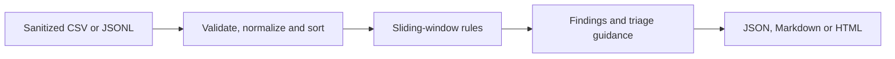

# Security Log Analyzer

> **Flagship expansion:** Offline authentication triage with CSV/JSONL ingestion, configurable rules, structured findings, and shareable reports. AI-assisted starter/expansion; Alex's independent contributions must be recorded separately.

An entry-level defensive security project for Alexander's new public portfolio.

**Status:** Functional educational implementation with automated checks. Alexander must personally reproduce and extend the results before claiming personal authorship.

## What it does

Reads a CSV of fictional authentication events and reports:

- Failed login counts by account and source IP
- Accounts with at least five failures in a ten-minute window
- Sources with failed logins against at least three distinct accounts **within a sliding time window**
- Successful logins that follow a series of failures from the same account and IP

These are **heuristics**, not proof of an attack. Real security analysts investigate context and false positives.

## Run

Requires Python 3.10+ and no third-party packages.

```bash
python analyzer.py sample_auth.csv
python analyzer.py sample_auth.csv --json --window 15 --threshold 5
python workbench.py sample_auth.jsonl --format json
python workbench.py sample_auth.csv --format markdown --output triage.md
python workbench.py sample_auth.csv --format html --output triage.html
python scenario_lab.py password_spray --csv spray-synthetic.csv
python benchmark.py --sizes 1000 5000 10000 --repetitions 3
python -m unittest discover -s tests -v
```

To use another authorized, sanitized dataset:

```bash
python analyzer.py path/to/events.csv --json
```

CSV columns: `timestamp` (ISO 8601 with timezone), `username`, `source_ip`, `event` (`success` or `failure`). Do not upload real credentials, private client data, or identifiable production logs to a public repository.

## Architecture



## Sample result (synthetic data)

| Signal | Result | Interpretation |
|---|---:|---|
| Failure burst | 5 attempts, one account | Investigate potential password guessing |
| Cross-account source | 3 accounts | Investigate possible password spraying |
| Success after failures | 1 occurrence | Check whether expected user activity |

No signal independently establishes malicious activity. All sample IPs use documentation-only address ranges.

## Flagship workbench (new)

`workbench.py` builds on the original `analyzer.py` for investigation-ready output:

- **Two input formats:** CSV and newline-delimited JSON (`.jsonl`)
- **Common UTC normalization:** timezone-aware timestamps required
- **Configurable policy:** failure threshold, distinct-account threshold, sliding-window duration
- **Structured finding IDs:** stable identifiers, categories, heuristic severities, evidence and recommended next steps
- **Three output formats:** machine-readable JSON, Markdown case notes, and self-contained HTML
- **Safe HTML rendering:** input-derived strings are escaped to prevent report injection
- **Safe Markdown rendering:** untrusted identities are flattened to one line and Markdown metacharacters escaped
- **22 automated tests:** detection, workbench, synthetic scenarios, benchmark structure, and security checks

## Realistic synthetic scenarios and reproducible performance

`scenario_lab.py` offers four **fictional** situations: credential guessing followed by success, a multi-account source, ordinary separated login errors, and events outside the active time window. These are rule demonstrations, not real security incidents.

`benchmark.py` measures median in-memory analysis time over deterministic generated events. One cloud run (November 8, 2026) measured 1,000 events in 3.019 ms, 5,000 in 11.301 ms, and 10,000 in 26.607 ms. These measurements exclude file loading and report output; host-dependent results are not evidence of production performance. Re-run on Alexander's own computer before claiming personal measurements.

This is a demonstrator for investigation support, **not** a full SIEM, production incident-response system, or claim that an alert proves a breach. Details: [architecture and limits](docs/FLAGSHIP-DESIGN.md) and [cloud validation](docs/VALIDATION.md).

### Reproducible workbench example

```bash
python workbench.py sample_auth.jsonl --format markdown
```

The synthetic ten-event sample produces three findings: one high-priority success-after-failures heuristic and two medium-priority login-pattern heuristics. Severity labels are **demonstration policy choices**, not CVSS scores.

See the [generated sample triage report](docs/SAMPLE-REPORT.md), produced from the supplied fictional JSONL data.

### Alex's personal ownership review

Use [the personal ownership checklist](docs/ALEX-OWNERSHIP.md) to reproduce the results, explain design decisions, add an original feature and test, and record authentic evidence of his own work.

## Interview talking points

1. Why sliding time windows help detect bursts of failed authentication.
2. Why a shared office IP or password reset can create false positives.
3. Why input validation and timezone-aware timestamps matter.
4. How to improve the project with event correlation, baselines, and a dashboard.

## Next steps for Alexander

- Run the commands and save screenshots of actual output and passing tests.
- Review each detection rule and explain it in his own words.
- Add a new test case, document what changed, and commit it.
- Add an independently authored change to this existing public repository; keep private business work separate.
- Add a case study describing only his personally implemented and verified work.

## Resume claim (only after personally running, testing, and understanding it)

> Developed a Python authentication-log analyzer using sliding-window detection to flag repeated login failures, multi-account source activity, and success-after-failure patterns; validated detection rules with automated tests.
